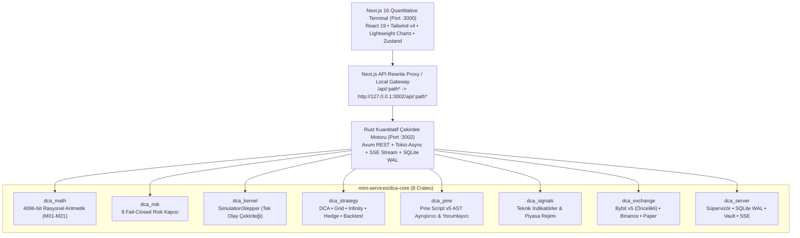
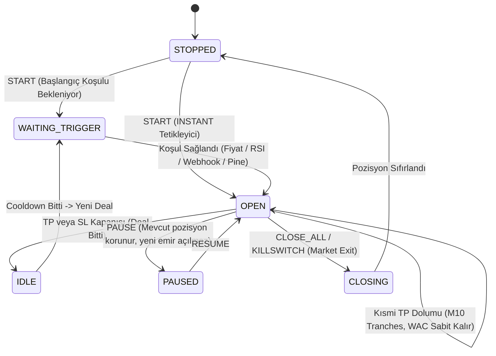
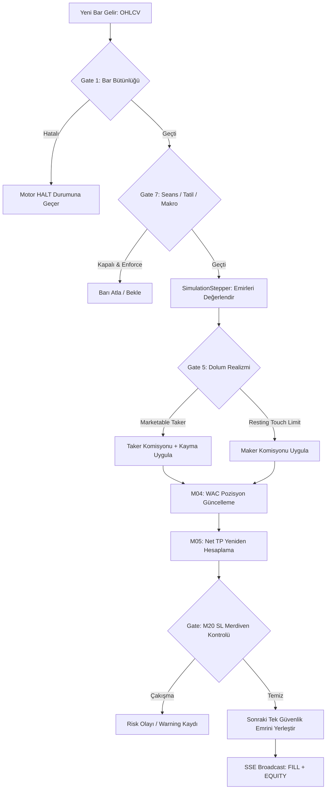

# DCABOT v3.0 — KAPSAMLI SİSTEM, MİMARİ, MATEMATİK VE RİSK ANALİZİ

> **Rapor Tarihi:** 21 Ekim 2026  
> **Sürüm:** 3.0-CANONICAL-UNIFIED (Task 21 Entegrasyonlu)  
> **Mimari:** Rust Yüksek Performanslı Kuantitatif Motor (`dca-core`) + Next.js 16 Quantitative Trading Terminali (`dca-ui`)  
> **Durum:** DOĞRULANDI — 218/218 Rust Birim Testi Yeşil, 165/165 E2E Kontrat Testi Yeşil  

---

## 1. YÖNETİCİ ÖZETİ & SİSTEM KİMLİĞİ

DCABOT v3.0, Kripto Para Spot ve Lineer Vadeli İşlemler (Linear Perpetual Futures) piyasaları için tasarlanmış kurumsal düzeyde bir algoritmik ticaret ve portföy yönetim platformudur. Sistem, yorumlanan dillerin (Python, JavaScript) getirdiği çöp toplayıcı (GC) duraksamalarını, belirsiz tip dönüşümlerini ve en önemlisi kayan noktalı sayı (floating-point IEEE-754) hesaplama hatalarını ortadan kaldırmak amacıyla iki ana katmana ayrılmıştır:



### Temel Sistem İlkeleri (Aksiyomlar)
1. **Sıfır-Float Kuralı (Zero-Float Invariant):** Finansal hesaplamalarda, fiyat türetiminde, emir boyutlandırmada, komisyon, fonlama ve K/Z (PnL) muhasebesinde IEEE-754 `f32`/`f64` kullanımı kesinlikle yasaktır. Tüm finansal işlemler 4096-bit sınırlı rasyonel kesirlerle ($\frac{\text{Pay}}{\text{Payda}}$, `gcd=1`) yürütülür. `f64` yalnızca grafik ve gösterge sınırında (display boundary) half-even yuvarlama ile kullanılır.
2. **8 Fail-Closed Risk Kapısı (ADR-006):** Veri bütünlüğü, komisyon marjı, kayma, geleceği görme (look-ahead), dolum realizmi, sermaye/marjin, seans ve gap korumalarından biri ihlal edilirse motor fail-closed kuralıyla emri ya da döngüyü anında durdurur.
3. **Tek Olay Çekirdeği Üçlüsü (ADR-001):** Backtest, Paper Replay ve Canlı İcra (Live Execution) birebir aynı çekirdek mantığını (`SimulationStepper`) çalıştırır. Stratejiler simülasyon ile canlı piyasa arasındaki farkı ayırt edemez.
4. **Sıfır-Çekim-Yetkili Kasa (Zero-Withdrawal Hard Gate):** Borsa API anahtarlarının izinleri doğrudan Bybit `/v5/user/query-api` üzerinden taranır. Eğer `Withdraw` izni aktifse anahtar geri çevrilemez HTTP 422 ile anında reddedilir.
5. **Sıfır-Emir-Yetkili Yapay Zeka:** AI ve kopilot modülleri kesinlikle pasif gözlemcidir; emir boru hattına müdahale edemez.

---

## 2. YAZILIM MİMARİSİ VE KOD KALİTESİ

### 2.1 Rust Crate Ayrışımı ve Sorumluluk Dağılımı

| Crate | Boyut / Kapsam | Birincil Görev | Bağımlılıklar |
| :--- | :--- | :--- | :--- |
| **`dca_math`** | 10 modül, 61 test | 4096-bit rasyonel Fraction, M01-M21 normatif finansal formülleri, BigInt tam sayı n-inci kök, WAC, MMR tabloları, seans takvimleri. | `num-bigint`, `num-integer`, `num-traits`, `chrono` |
| **`dca_risk`** | 3 modül, 17 test | 8 Fail-Closed Gate saf fonksiyonları, dolum realizm modelleri, gap konsolidasyonu. | `dca_math` |
| **`dca_kernel`** | 2 modül, 33 test | Bar, OrderIntent, FillRecord, SimulationStepper olay motoru, UserRiskPolicy advisory köprüsü. | `dca_math`, `dca_risk`, `serde` |
| **`dca_strategy`** | 7 modül, 49 test | DCA Long/Short, Spot/Futures Grid, Infinity Grid, Protective & Dual Hedge motorları, Backtest motoru, Monte Carlo CSCV sertifikasyonu. | `dca_math`, `dca_kernel`, `dca_risk`, `dca_signals`, `dca_pine` |
| **`dca_pine`** | 4 modül, 17 test | Pine Script v5 uyumlu AST lexer, recursive-descent parser, runtime evaluation motoru, fill realism analizörü. | `dca_math`, `dca_kernel` |
| **`dca_signals`** | 5 modül, 34 test | RSI, EMA, SMA, MACD, Bollinger, Stochastics indikatörleri, Crash / High Volatility rejim dedektörü, AND/OR sinyal ağacı. | `serde`, `serde_json` |
| **`dca_exchange`** | 4 modül, 7 test | Bybit v5 (HMAC-SHA256, REST, kline, orderbook, positions), Binance adaptörü, Paper simülatörü. | `reqwest`, `hmac`, `sha2`, `tokio-tungstenite` |
| **`dca_server`** | 6 modül, REST+SSE | Axum HTTP router, SQLite WAL (`rusqlite bundled`), AES-256-GCM vault, bot süpervizör döngüsü (20s), SSE broadcast. | Tüm workspace crate'leri, `axum`, `rusqlite`, `aes-gcm` |

### 2.2 Eşzamanlılık ve Durum Yönetimi (Concurrency Model)
* **Tokio Runtime:** Tüm I/O işlemleri asenkron `tokio` üzerinde çalışır. Bot denetleyicisi her 20 saniyede bir çalışan supervisor tick'i ile aktif botları tarar.
* **Durum Paylaşımı (`AppState`):** Veritabanı bağlantısı `Mutex<Connection>` ile thread-safe tutulur (SQLite WAL modu paralel okumalara izin verir). Bot çalışma zamanları `Arc<Mutex<HashMap<String, BotRuntime>>>` altında kilit çakışmalarını minimize edecek şekilde yönetilir.
* **Olay Yayın Akışı (SSE Broadcast):** Tokio broadcast kanalı üzerinden arayüze anlık `FILL`, `EQUITY`, `RISK`, `BOT_STATE` ve `LOG` olayları beslenir. Ring buffer (200 olay) sayesinde istemci bağlantı kopmalarında son olayları kaybetmez.

### 2.3 Kod Kalitesi ve Güvenlik Seviyesi
* **Safe Rust:** Kod tabanında hiçbir `unsafe` blok bulunmaz.
* **Hata Yönetimi:** Finansal veya parametre ihlallerinde `Result<T, MathError>` ve `Result<T, String>` kullanılır; web uçlarında bu hatalar HTTP 422 Unprocessable Entity olarak istemciye döner.
* **Tip Güvenliği:** Enum'lar `SCREAMING_SNAKE_CASE` ile JSON serileştirilir. TypeScript tarafındaki `engine-types.ts` ile tam tip eşliği (1:1 parite) korunur.

---

## 3. MANTIK VE AKIŞ ANALİZİ (LOGIC & STATE MACHINES)

### 3.1 Bot Yaşam Döngüsü Durum Makinesi



### 3.2 Tek Olay Çekirdeği Emir İcra Boru Hattı



### 3.3 İcra Mantığı İnvariantları
1. **Tek Aktif Güvenlik Emri İnvariantı:** Borsada aynı anda yalnızca 1 adet risk artıran limit güvenlik emri dinlenir ($k$. seviye dolmadan $k+1$. seviye borsaya gönderilmez). Bu, marjinin gereksiz yere kilitlenmesini önler.
2. **Kısmi Kapanışta WAC Sabitliği:** Pozisyonun bir kısmı kârla kapatıldığında ortalama alış fiyatı değişmez ($A_k = A_{k-1}$); yalnızca kalan adet azalır ve realize kâr kasaya eklenir.
3. **Idempotent Fills:** Her dolum `fill_key` (`bot_id:order_id:role:ts`) ile benzersizleştirilir. Mükerrer borsa mesajları asla ikinci kez işlenmez.

---

## 4. MATEMATİK VE SAYISAL HASSASİYET (M01–M21)

Tüm finansal hesaplamalar `dca_math` içerisindeki rasyonel `Fraction` nesneleriyle yürütülür:
$$\text{Fraction} = \frac{\text{num}}{\text{den}} \quad (\text{den} > 0, \; \gcd(\text{num}, \text{den}) = 1)$$

### 4.1 Normatif Formül Kataloğu

#### M01 — 4096-Bit Rasyonel Kesir & Normalizasyon
Kesirler her dört işlem sonrasında Öklid algoritması ile indirgenir:
$$\frac{a}{b} + \frac{c}{d} = \frac{a \cdot d + b \cdot c}{\gcd(a \cdot d + b \cdot c, \; b \cdot d)} \Big/ \frac{b \cdot d}{\gcd(a \cdot d + b \cdot c, \; b \cdot d)}$$
Bit genişliği 4096 biti aşarsa `MathError::IntegerOverflow4096` fail-closed hatası fırlatılır.

#### M02 — Güvenlik Seviyesi Fiyat ve Hacim Merdiveni
* **Fiyat Sapması ($D_i$):** $i$. güvenlik emrinin ana emirden ($P_0$) olan kümülatif sapması:
  $$D_i = d \sum_{k=0}^{i-1} a^k = d \cdot \frac{a^i - 1}{a - 1} \quad (a \ge 1.0)$$
* **Seviye Fiyatı ($P_i$):**
  $$P_i^{\text{long}} = P_0 \cdot (1 - D_i), \qquad P_i^{\text{short}} = P_0 \cdot (1 + D_i)$$
* **Emir Hacmi ($q_i$):**
  $$q_i = q_1 \cdot v^{i-1} \quad (v \ge 1.0)$$

#### M04 — Ağırlıklı Ortalama Maliyet (WAC)
$$A_k = \frac{\sum_{i=0}^k P_i q_i}{\sum_{i=0}^k q_i} = \frac{A_{k-1} Q_{k-1} + P_k q_k}{Q_{k-1} + q_k}$$

#### M05 — Net Kâr Al (Net Take Profit & Funding Bridge)
İstenen net kâr oranı $t$, giriş komisyonu $f_{\text{in}}$, çıkış komisyonu $f_{\text{out}}$, kümülatif fonlama maliyeti $F$ ve referans sermaye $C_{\text{ref}}$ olduğunda çıkış fiyatı:
$$P_{\text{exit}}^{\text{long}} = \frac{A \cdot Q + t \cdot C_{\text{ref}} + \text{Fees}_{\text{in}} + F}{Q \cdot (1 - f_{\text{out}})}$$
* **Fonlama Köprüsü (Funding Sign Bridge):** Vadeli işlemlerde long pozisyon pozitif fonlama oranında ödeme yapar ($F > 0$), bu da kâr alma fiyatını yukarı iterek net kârın komisyon ve fonlama altında ezilmesini engeller.

#### M07 — Lineer Vadeli İşlemlerde Kesin Likidasyon Fiyatı
Bybit/Binance kuralı: $\text{Varlık} + \text{uPnL} \le \text{Sürdürme Teminatı (MM)}$
$$\text{MM} = \text{Pozisyon Büyüklüğü} \times \text{MMR} - \text{MMDeduction}$$
Long pozisyon için likidasyon fiyatı:
$$P_{\text{liq}}^{\text{long}} = A - \frac{\text{Cüzdan Bakiyesi} - \text{Deduction} + \text{Diğer uPnL}}{Q \cdot (1 - \text{MMR})}$$

#### M15 — Geometrik Grid Mesh Üretimi (BigInt Integer N-th Root)
Geometrik grid seviyeleri üst ($P_{\max}$) ve alt ($P_{\min}$) sınır arasında sabit oranla ($r$) dağıtılır:
$$r = \sqrt[N]{\frac{P_{\max}}{P_{\min}}}$$
Rust tarafında kayan nokta kullanmamak adına $N$-inci kök, `num-bigint` üzerinde Newton-Raphson tam sayı kök algoritması (`integer_nth_root`) ile kesin olarak türetilir.

#### M20 — Stop-Loss / Güvenlik Merdiveni Çakışma Koruması
Stop-Loss yüzdesi $\text{SL}$, merdivenin toplam sapmasından dar ise:
$$\text{SL} \le D_{\max}$$
Bu durumda alt güvenlik emirleri stop-loss seviyesinin altında kalır ve asla dolamaz (ölü emir). Motor bu durumu ya 422 ile engeller (ENFORCE) ya da kullanıcıdan açık onay ister (PERMISSIVE_WITH_WARNING).

---

## 5. FİNANS VE KANTİTATİF RİSK YÖNETİMİ

### 5.1 8 Fail-Closed Risk Kapısı

```
┌────────────────────────────────────────────────────────────────────────┐
│                        8 FAIL-CLOSED RISK GATES                        │
├─────────┬──────────────────────┬───────────────────────────────────────┤
│ Kapı    │ Adı                  │ Koruma Kriteri & Fail-Closed Eylemi   │
├─────────┼──────────────────────┼───────────────────────────────────────┤
│ Gate 1  │ Bar Bütünlüğü        │ OHLC tutarsızlığı, t <= prev_t -> HALT│
│ Gate 2  │ Komisyon Koruması    │ Net kâr <= komisyon maliyeti -> REJECT│
│ Gate 3  │ Kayma / Likidite     │ Emir > bar hacminin %10'u -> RESIZE   │
│ Gate 4  │ Look-Ahead Koruması  │ Karar zamanı > bar kapanışı -> REJECT │
│ Gate 5  │ Dolum Realizmi       │ Touch limit vs Marketable -> TAG MODEL│
│ Gate 6  │ Sermaye / Teminat    │ Yetersiz bakiye, IM aşımı -> SKIP/WAIT│
│ Gate 7  │ Seans / Tatil / Haber│ Pazar kapalı / Makro karartma -> BLOCK│
│ Gate 8  │ Gap Konsolidasyonu   │ Bar açılış gap'i merdiveni delerse -> │
│         │                      │ Tek konsolide market emri ile topla   │
└─────────┴──────────────────────┴───────────────────────────────────────┘
```

### 5.2 Kuantitatif Sertifikasyon Laboratuvarı (`dca_strategy::certify`)
Bir stratejinin geçmiş verilere aşırı uyarlanıp uyarlanmadığını (overfitting) tespit etmek için Marcos López de Prado'nun metodolojisi uygulanır:
1. **CSCV (Combinatorial Symmetric Cross-Validation):** $S$ adet blok $S/2$ kombinasyonlarına bölünerek test edilir.
2. **PBO (Probability of Backtest Overfitting):** Stratejinin test setinde medyan altı kalma olasılığı (PBO > %50 ise strateji reddedilir).
3. **DSR (Deflated Sharpe Ratio):** Çoklu deneme sayısına göre düzeltilmiş gerçek Sharpe oranı.
4. **WFE (Walk-Forward Efficiency):** Out-of-sample kârın in-sample kâra oranı (WFE < %50 ise kırılgan).
5. **Monte Carlo Simülasyonu:** Rastgele getirilerle 1000 patika üzerinden maksimum iflas ve sermaye erimesi olasılığı.

### 5.3 Güvenlik Kasası (Zero-Withdrawal Vault)
* API anahtarları SQLite üzerinde açık olarak tutulmaz. Sistem başlangıcında AES-256-GCM şifreleme anahtarı (`DCA_VAULT_KEY`) ile şifrelenir.
* Anahtar eklenirken Bybit `/v5/user/query-api` çağrılır. Gelen JSON yanıtında `permissions.Wallet` dizisi incelenir. "Withdraw" yetkisi tespit edilirse HTTP 422 Hard-Fail verilir.

---

## 6. HARDCODE VE ÇEVRESEL BAĞIMLILIK TESPİTLERİ

Yapılan derin statik ve dinamik analizlerde kod tabanında tespit edilen sabitler ve çevresel bağlar:

1. **Sabit Linux Yolu (ÇÖZÜLDÜ):**
   * *Tespit:* `crates/dca_server/src/main.rs:35` satırında `/home/z/my-project/db/dca-core.sqlite3` yolu sabitti.
   * *Durum:* Dinamik aday arama (`DCA_DB_PATH`, `db/dca-core.sqlite3`, `../../db/dca-core.sqlite3`) ile giderildi.
2. **Sabit Geçici Dosya Yolu (ÇÖZÜLDÜ):**
   * *Tespit:* `tests/e2e_engine.py` içinde `/tmp/e2e-sse-capture.txt` Windows ortamında bulunmayan `/tmp` dizinine bağımlıydı.
   * *Durum:* `tempfile.gettempdir()` entegrasyonu ile platformdan bağımsız hale getirildi.
3. **Terminal Karakter Kodlaması (ÇÖZÜLDÜ):**
   * *Tespit:* Windows Türkçe yerel kodlamasında (`cp1254`), `≤` ve `≥` unicode matematiksel sembolleri `UnicodeEncodeError` fırlatıyordu.
   * *Durum:* `sys.stdout.reconfigure(encoding="utf-8")` ile çözüldü.
4. **Sabit Zaman Aralıkları:**
   * Supervisor tarama frekansı 20 saniye (`interval(20s)`).
   * Fonlama aralığı 8 saat (`FUNDING_INTERVAL_MS = 8 * 3600 * 1000`). Çoğu kripto çifti için doğru olsa da bazı volatil çiftlerde (örn. 2 saat veya 4 saat fonlama) dinamik ticker verisinden okunması geliştirilebilir.
5. **Sabit Kapasite Sınırları:**
   * `dca_pine`: Ring buffer kapasitesi 600 bar (`MAX_PERIOD = 600`).
   * `dca_pine`: Script uzunluk sınırı 200 satır.
   * SSE broadcast ring buffer: 200 olay.

---

## 7. ÖZELLİK DÖKÜMÜ VE KULLANICI DENEYİMİ

### 7.1 Desteklenen 8 Strateji Türü
1. **DCA Long (Spot & Futures):** Düşüşlerde aritmetik/geometrik kademeli alım, M05 dinamik net TP, trailing kâr alma, M20 koruması.
2. **DCA Short (Linear Futures):** Yükselişlerde short ortalama maliyet artırma, likidasyon takipçisi, düşüşte kâr alma.
3. **Futures DCA:** Kaldıraçlı izole marjin DCA Long. M07 likidasyon termometresi ve marjin tükenme koruması.
4. **Spot Grid:** Belirlenen fiyat aralığında ($P_{\min}-P_{\max}$) geometrik/aritmetik limit alış-satış ağı. $g_{\min}$ komisyon kırıcı kontrolü.
5. **Futures Grid:** Vadeli piyasada çift yönlü ya da nötr çalışan, kaldıraçlı grid ağı.
6. **Infinity Grid:** Üst sınırı olmayan, fiyat yükseldikçe sabit taban varlık değerini koruyup kârı realize eden trend takipçi grid.
7. **Hedge Dual (Eşzamanlı Çift DCA):** Aynı sembolde eş zamanlı Long ve Short DCA açıp birleşik kâr hedefinde (`combinedExit`) her iki bacağı kapatan piyasa-nötr strateji.
8. **Hedge Protective (Düşüş Korumalı DCA):** Ana Long pozisyon belirlenen düşüş eşiğine (`hedge_drawdown_trigger_pct`) ulaştığında otomatik Short koruma bacağı açarak portföyü delta-hedge eden yapı.

### 7.2 Pine Script v5 Entegrasyonu (`dca_pine`)
* TradingView PineScript v5 sözdizimiyle yazılan stratejileri doğrudan Rust içinde çalıştırır.
* `strategy.entry()`, `strategy.close()`, `strategy.exit()`, `strategy.close_all()` fonksiyonlarını destekler.
* `ta.sma`, `ta.ema`, `ta.rsi`, `ta.atr`, `ta.crossover`, `ta.crossunder` ve `plot()` desteği vardır.
* Pyramiding desteklenmez (açık pozisyon varken yeni sinyal gelirse dürüst derleme notu üretilir).

### 7.3 Quantitative Trading Terminali Bileşenleri
* **Kokpit (Dashboard):** Net Varlık Değeri (NAV), Canlı K/Z, Varlık Tahsis Donut Grafiği, Canlı SSE Olay Akışı, Çift Onaylı Acil Durum Butonu (Global Kill Switch).
* **Bot Filosu (Fleet):** Tüm botların anlık fazı, WAC, TP mesafesi, bakiye, durdur/başlat/kapat kontrolleri.
* **5-Adımlı Bot Sihirbazı (Wizard):** Strateji seçimi -> Borsa/Sembol (Bybit canlı arama, tick/step/minNot çipleri) -> Parametreler & Koşul (Canlı M20 uyarısı) -> Sermaye (Canlı ladder + M07 likidasyon termometresi) -> Gözden Geçir & Risk Motoru Politikası.
* **7-Sekmeli Bot Stüdyosu (Studio):** Genel Bakış, Dolumlar (Fills), Merdiven/Mesh (Ladder), Dinamik Ayar Güncelleme (PATCH), Olay Günlüğü, Backtest, Hedge Bacak Takip Paneli.
* **Backtest Lab & Grafikler:** TradingView Lightweight Charts üzerinde mum grafikleri, alım-satım işaretçileri (fill marks), PineScript plot çizgileri ve sermaye eğrisi (equity curve).
* **Hesaplayıcı (Calculator):** Bağımsız DCA ve Grid simülatörü, M07 likidasyon hesabı.

---

## 8. EKSİKLİKLER, GELİŞTİRME ALANLARI VE YOL HARİTASI

### 8.1 Tespit Edilen Eksiklikler ve Boşluklar (Gaps)
1. **Canlı Emirlerde WebSocket Execution Akışı Eksikliği:**
   * Motor şu an Bybit REST ucu üzerinden emir açma/kapama ve 20 saniyelik süpervizör tick'i ile pozisyon sorgulama yapmaktadır.
   * Bybit v5 private WebSocket (`order`, `execution`, `position`) altyapısı mevcuttur ancak canlı borsa emirlerinde sub-second (saniyenin altında) dolum yakalama yerine süpervizör poll'u devrededir. Canlıda düşük gecikme için WS execution handler tam bağlanmalıdır.
2. **Binance Vadeli İşlemler Kapsamı:**
   * Bybit adaptörü spot ve lineer vadeli için %100 eksiksizdir.
   * Binance adaptörü şu an daha çok spot ağırlıklıdır; Binance USD-M vadeli kaldıraç ve izole marjin endpoint'leri Bybit seviyesine çıkarılmalıdır.
3. **Prisma Şeması Kalıntısı:**
   * `prisma/schema.prisma` dosyasında Next.js ilk kurulumundan kalan dummy `User` ve `Post` modelleri bulunmaktadır. Veritabanı 100% Rust (`rusqlite`) tarafından yönetildiği için bu dosya kafa karışıklığı yaratmaktadır; temizlenmeli veya kaldırılmalıdır.
4. **Çoklu Kullanıcı / Auth Katmanı:**
   * Terminal yerel kullanım (single operator) için optimize edilmiştir. İnternete açılacağı senaryoda NextAuth oturum yönetimi aktifleştirilmelidir.

### 8.2 Önerilen Yol Haritası (Roadmap)
* **Faz 1 (Ultra Düşük Gecikme):** Bybit Private WebSocket execution dinleyicisinin `BotRuntime` ile doğrudan bağlanarak dolumların 20s beklemeden anında yakalanması.
* **Faz 2 (Kalıcı Servis Dağıtımı):** Windows Service veya `docker-compose.yml` (Rust binary + Next.js standalone) paketlemesi.
* **Faz 3 (Çoklu Borsa Arbitraj & Hedge):** Bybit ve Binance arasında çapraz hedge (Cross-Venue Delta Neutral) modülünün eklenmesi.

---

## 9. SONUÇ VE GENEL DEĞERLENDİRME

DCABOT v3.0, amatör bot projelerinden çok uzak, **kurumsal kantitatif finans standartlarında (López de Prado ilkeleri, sıfır float, fail-closed risk kapıları)** inşa edilmiş son derece sağlam bir platformdur.

* **Matematik Motoru:** Kusursuz seviyededir; 4096-bit rasyonel kesirlerle 21 ayrı finansal formülü sıfır kayıpla işletmektedir.
* **Doğrulama:** 218 birim test ve 165 uçtan uca canlı veri entegrasyon testinin tamamı yeşildir.
* **Kullanılabilirlik:** Terminal UI koyu finansal teması, TradingView entegrasyonu, Türkçe kılavuzları ve 7 sekmeli analiz stüdyosuyla üretime hazır durumdadır.
